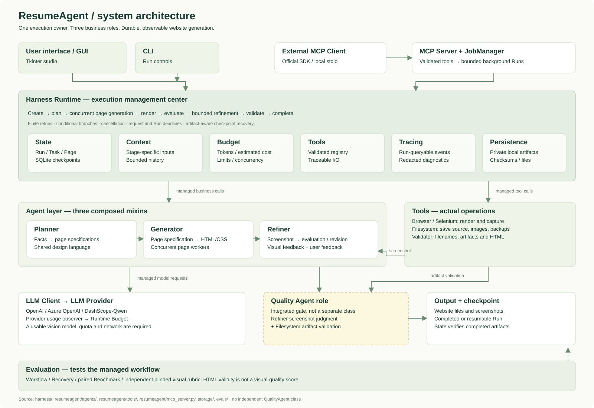
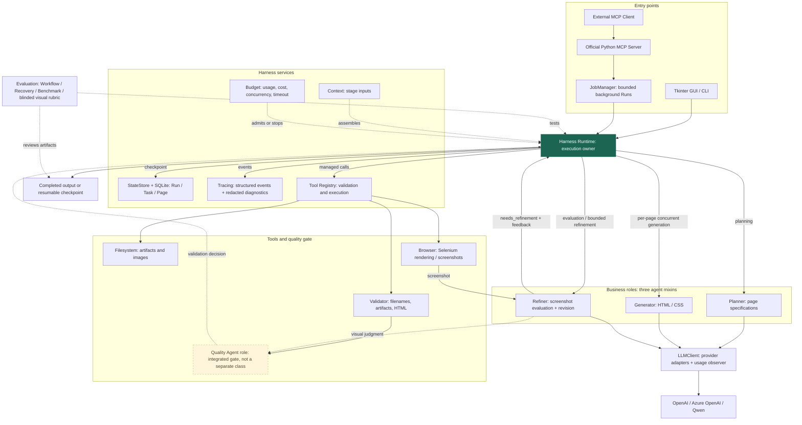
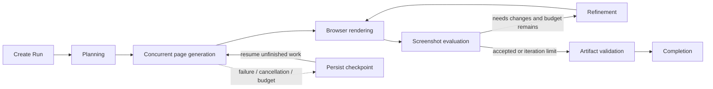

# ResumeAgent

### An Agent Harness for Personal Website Generation

ResumeAgent turns a factual personal profile into a multi-page website, then
renders it in a browser and uses screenshot feedback to refine the result. Its
Python Harness owns execution, recovery and resource limits; the agents focus on
planning and generating the website.

[Project showcase](https://bj-liu.github.io/resumeagent/) ·
[Architecture](docs/architecture.md) · [Demo script](docs/DEMO_SCRIPT.md) ·
[Release verification](docs/RELEASE_CHECKS.md) · [Security audit](docs/SECURITY_AUDIT.md) · [MIT license](LICENSE)

> The showcase URL is the intended GitHub Pages destination. Deployment status is
> recorded in the release checks; a prepared site is not evidence of deployment.

## Project overview

Provide biography, achievements, experience, skills and design feedback in
English or Chinese. Planner produces validated page specifications; Generator
writes HTML and optional CSS; Selenium captures each page; Refiner evaluates
screenshots and revises code within configured limits. Files, usage and execution
state remain available locally after a failure.

## Motivation

A website-generation prompt alone does not manage interrupted requests, partial
success, browser failures or spending limits. ResumeAgent makes these concerns
explicit so a successful page can be retained while another page is retried.
It also keeps factual profile data separate from visual design instructions:
design can change without inventing achievements or contact information.

## Key features

- Multi-page asynchronous generation with shared site planning and design policy.
- Screenshot-driven evaluation, bounded refinement and user-directed edits.
- Tkinter creative-studio GUI, CLI and an official-SDK MCP stdio server.
- SQLite Run / Task / Page state, artifact checkpoints and restart recovery.
- Token accounting, estimated costs, request concurrency and deadline limits.
- Named, validated tools and structured traces with redacted diagnostics.
- Offline workflow/recovery tests, paired benchmarks and a separate visual rubric.

## System architecture



<!-- ARCHITECTURE_BEGIN -->

<!-- ARCHITECTURE_END -->

Runtime controls the workflow. Context assembles bounded inputs, StateStore
persists progress, Budget controls admission and Tracing records execution.
Agents use the managed LLM and tool paths; Browser and Filesystem perform I/O.
MCP exposes the same Runtime through bounded background jobs rather than creating
a second orchestration implementation. See [control and data flow](docs/architecture.md).

## Agent design

| Role | Input | Output |
|---|---|---|
| Planner | User facts, feedback, optional references | Validated JSON page specifications |
| Generator | Page specification and shared context | HTML and optional independent CSS |
| Refiner | Screenshot, source, facts and feedback | Visual evaluation or revised source |
| Quality Agent **role** | Visual judgment plus artifact validation | Continue refinement, validate, or finish |

There are three agent mixins, composed by `HomepageDesignAgent`. **There is no
standalone `QualityAgent` class.** Quality checking is integrated into Refiner's
`evaluate_screenshot_async` and Filesystem validation. The diagram's quality role
does not imply an additional autonomous agent or a separate model call.

Planner output uses `<designed_pages>` around a JSON array. Existing filename
validators reject absolute paths, traversal and duplicate page filenames.
English/Chinese prompts share the output protocol. User facts are the only
source of resume claims; generated content should still be reviewed by its owner.

## Harness engineering

| Module | What it manages |
|---|---|
| `harness/runtime.py` | Stage order, per-page workers, conditional refinement, finite retries, cancellation and resume |
| `harness/state.py`, `storage/database.py` | SQLite Run / Task / Page records and checkpoints |
| `harness/context.py` | Stage-specific facts, page specifications, feedback, paths and bounded history |
| `harness/budget.py` | Token/cost limits, request concurrency, request timeout, Run deadline and iteration count |
| `harness/tools.py` | Tool registration, argument validation, results and errors |
| `harness/tracing.py` | Run-queryable structured events and redacted developer diagnostics |
| `harness/jobs.py` | Bounded background jobs and MCP-origin access checks |

The page workers are concurrent; one shared Selenium browser is protected by a
lock. Recovery verifies completed artifacts before skipping them. Budget stops
new work when limits are reached; an in-flight provider call may finish later
and its late usage is recorded. These limits are not a provider-side billing cap.

## Execution workflow



`Run` is the website job, `Task` is an individual stage execution, and `Page` is
one generated document. Failures preserve errors and completed work. Resume is
artifact-aware; it does not blindly regenerate every page.

## MCP integration

The server uses the [official Python MCP SDK](https://github.com/modelcontextprotocol/python-sdk)
over **local stdio**, with three tools:

| Tool | Purpose |
|---|---|
| `generate_homepage` | Validate a profile, submit a Runtime job, return its Run ID |
| `get_generation_status` | Query overall progress, page state and usage |
| `preview_homepage` | Return confined local preview metadata for a Run/Page pair |

Inputs are bounded and validated. Clients cannot supply arbitrary output paths,
API keys or model overrides. Preview returns local file information, not a hosted
website. MCP jobs must belong to the server's MCP origin. The stdio process must
stay alive while background jobs execute. This is not an authenticated multi-user
HTTP service or an execution sandbox.

## Installation

Python 3.10+ is required. The release is checked with Python 3.10 in the
`machine_learning` conda environment. Use a dedicated environment for a new install:

```bash
git clone https://github.com/bj-Liu/resumeagent.git
cd resumeagent
conda create -n machine_learning python=3.10
conda activate machine_learning
python -m pip install -r requirements.txt
```

Tkinter is included in standard Windows Python/conda installations. Some Linux
distributions require their `python3-tk` package and a graphical display. Install
Chrome, Edge or Firefox for real rendering. Selenium Manager resolves a driver
when online; set `WEBDRIVER_PATH` to a compatible local driver for offline use.
Mock tests do not need browser installation or paid API access.

## Configuration

Copy `config.example.yaml` to `config.yaml` and adjust non-secret settings. The
loader checks `RESUMEAGENT_CONFIG`, then root/package YAML paths. Missing private YAML
is allowed for clean-checkout imports and offline tests. YAML environment values
fill missing environment variables; already-set environment values take priority.

`.env.example` lists supported environment names. **The application does not
automatically load `.env`**: export values in your shell or use your launcher.

```powershell
# PowerShell example; do not put a real key in source control.
$env:LLM_TYPE = "qwen"
$env:DASHSCOPE_API_KEY = "<your local key>"
python main.py --gui --model <an-available-multimodal-model>
```

Set `LLM_TYPE: qwen` and `model` in YAML when using Qwen as the normal default.
OpenAI-compatible, Azure OpenAI and DashScope/Qwen branches remain available in
`resumeagent/llm/client.py`. Model availability, regional endpoints, image support
and account quota must be checked with the provider. No model is promised to be
free or permanently available. Do not commit local YAML, `.env`, state databases,
profile catalogs, logs or generated personal websites.

## GUI usage

```bash
python main.py --gui
# Optional explicit model/output folder:
python main.py --gui --model MODEL --save_file ./my-website
```

Enter your actual profile, select language/CSS framework, choose a fresh output
folder, and click **Plan**. Review the page specifications, then **Auto Generate**.
Use page selection, Canvas preview, Create Website, Complete Page, Refine Page,
Refine Website, Restore Backup and Open Website as needed. Execution stays managed
by Harness; errors include a Run ID and local diagnostics path. Cancel and wait
for background work to drain before closing the window. GUI operation requires
a display; it is independent of the MCP server.

## CLI usage

```bash
python main.py --basic_information "A fictional AI graduate student" \
  --experience "A Python website-generation prototype" \
  --professional_skills "Python, SQLite, HTML, CSS" \
  --feedback "Use a clear editorial layout; do not invent achievements" \
  --max_iterations 1 --max_concurrency 2 --request_timeout 120 \
  --max_run_seconds 600 --max_cost 1

python main.py --status RUN_ID
python main.py --trace RUN_ID
python main.py --resume RUN_ID
python main.py --cancel RUN_ID
```

Use the same `--storage_root` / `--database` when inspecting or resuming a custom
store. Default Runtime artifacts go to `storage/outputs/<run_id>/`; `--save_file`
chooses an explicit output folder. `--refine_times` aliases `--max_iterations`.
`python -m resumeagent` is also supported. A completely offline recovery example:

```bash
python examples/harness_demo.py --fail-once
```

## MCP client usage

```bash
# Official SDK client + real stdio transport, mocked LLM/browser, no API charge:
python examples/mcp_client.py

# Live calls require local credentials, a multimodal model and browser:
python examples/mcp_client.py --live --browser edge

# A server launched by another MCP client:
python mcp/server.py --mock
python mcp/server.py --browser edge --model MODEL --max-cost 1
```

Adapt [examples/mcp_config.json](examples/mcp_config.json) to an absolute server
path and the Python executable inside your environment. The example intentionally
uses `--mock`; remove it only when live API use is intended. Server options include
`--storage-root`, `--max-active` and `--max-pending`. Do not add `mcp/__init__.py`:
the launch directory must not shadow the installed official `mcp` package.

## Evaluation & testing

```bash
python -m compileall resumeagent harness storage mcp evals examples tests
python -m evals.run_tests --output test-artifacts/tests.log
python evals/benchmark.py --output test-artifacts/benchmark
```

The default benchmark uses fixed fictional fixtures and mocks. Baseline/refined
variants use identical input hashes and alternating order. Recovery experiments
are separate from primary success rates. Reports contain task/page success,
duration, tokens, estimated cost, iterations, recovery and independent structural
HTML checks. Mock token counts are synthetic; their estimated cost is **not paid
API expenditure**. HTML checks do not measure visual quality.

`evals/visual.py` supports independent blinded human screenshot evaluation and
rejects mock screenshots for that purpose. No human visual score has been invented.
For a real browser with mock LLM and no model fees (PowerShell):

```powershell
$env:RESUMEAGENT_REAL_BROWSER = "edge"
python -m unittest discover -s evals -k real_selenium -v
```

See [measured release results](docs/RELEASE_CHECKS.md) and
[machine-readable public evidence](showcase/data/evidence.json). These describe
the environment and distinguish mock transport tests, real browser checks and
historical generated screenshots. A release check does not prove every live
provider/account/model configuration works.

## Cost tracking

LLM usage callbacks feed Runtime budgets and persisted Run usage. The legacy token
ledger is retained. Configure per-million input/output `BudgetLimits.prices` using
one consistent currency when enforcing `max_cost`. Legacy model rates may mix
USD and CNY; they are estimates, not a currency conversion or provider invoice.
Token limits, concurrency, retries and time limits provide additional controls.
Do not interpret a numeric default cost ceiling as a guaranteed RMB billing cap.

## Project structure

```text
resumeagent/          agents, bilingual prompts, LLM adapters, tools, frontend
harness/              runtime, state, context, budget, tools, tracing, jobs
storage/              SQLite implementation; private runs/ and outputs/
mcp/server.py         official-SDK server launch shim
evals/                workflow, recovery, benchmark, visual evaluation
tests/                regression and GUI smoke tests
examples/             offline Harness demo and MCP client
gui_assets/           GUI background asset
docs/                 architecture, release checks and recording script
showcase/             static presentation; no API calls or backend
scripts/              static validation, build and release packaging
.github/workflows/    tested showcase deployment pipeline
```

`gui_old.py`, `gui_2.py` and old prompt variants are retained as historical source;
the active GUI is `resumeagent/frontend/gui.py`. They are not additional launch
entry points. Private backups, local reports and generated outputs stay outside
the public source package. Build the standalone showcase with:

```bash
python -m pip install -r requirements-showcase.txt
python scripts/build_showcase.py --output release-dist/showcase
python -m http.server 8080 --directory release-dist/showcase
```

Node 22+ is used only for JavaScript syntax checking, not as an application
dependency. GitHub Actions validates HTML/CSS/JS and local asset paths before
uploading the static artifact. In repository Settings → Pages, select **GitHub
Actions** if it is not already enabled. See [deployment notes](docs/RELEASE_CHECKS.md).

## Limitations

- Live execution needs a usable provider account, sufficient quota, network access
  and a compatible multimodal model. No paid API calls are part of release tests.
- Generated HTML runs in a browser; do not treat it as trusted or sandboxed code.
- SQLite, diagnostics, screenshots and output files can contain personal data.
  Keep them local and review material before sharing.
- A single browser serializes rendering; generation concurrency is separate.
- Visual quality is subjective. Current tests verify behavior and structure, not
  a universal design-quality score or benchmark advantage over other products.
- MCP is a local stdio integration, not a hosted service. Cancellation cannot
  necessarily abort an already-submitted provider request.
- The demo recording is pending. The showcase labels its historical generated
  screenshot and recording placeholder explicitly.

## Roadmap

- Record the end-to-end demo using the published script and public fictional facts.
- Extend provider-specific installation and live integration coverage.
- Collect blinded visual evaluations on fixed inputs before making quality claims.
- Improve browser isolation and packaging without duplicating Harness ownership.
- Keep API, prompt and state compatibility covered by regression tests.
