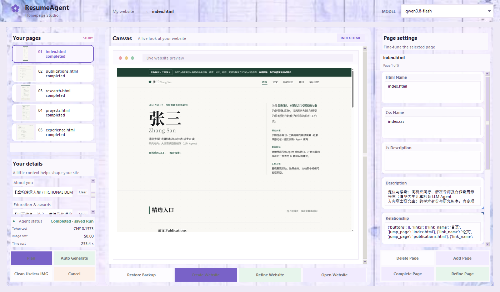
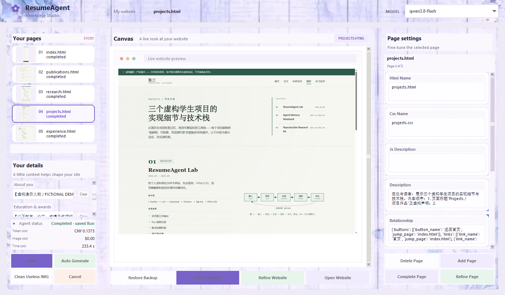

# ResumeAgent

### 基于多智能体与 Harness 的个人主页生成系统

ResumeAgent 是一个面向求职者、科研人员及专业人士的 AI 个人主页生成工具。用户只需提供个人经历、教育背景、科研成果、项目经验及设计偏好，即可通过桌面端 GUI 自动生成具有个性化设计的多页面个人网站，无需手动编写 HTML 或 CSS。

项目采用多智能体协作架构，通过页面规划、内容生成、浏览器渲染、截图评估与迭代优化，完成从个人资料到网站生成的完整流程。

除了网页生成本身，项目还围绕长流程 Agent 任务设计了一套独立的 **Harness 执行框架**，负责统一管理任务编排、状态持久化、上下文控制、资源预算、工具调用、执行追踪与故障恢复。

**在线展示：** [ResumeAgent Showcase](https://bj-liu.github.io/resumeagent/)  
**演示网站：** [在线查看](https://bj-liu.github.io/resumeagent/demo/)

---

## 一、项目展示

### Homepage Studio

[](showcase/assets/homepage-studio.png)

桌面端交互界面，提供个人资料输入、页面管理、网页预览、模型选择及 Agent 执行状态监控等功能。

### 页面精修

<a href="showcase/assets/homepage-studio-detail.png">
  
</a>

展示指定页面精修完成后的实际网页效果，以及对应的页面设置与生成状态。

以上截图均来自真实完成的生成任务，通过只读方式恢复展示，并非静态界面仿制。点击图片可查看完整原图。

### Demo 演示

**演示内容：** 个人资料输入、Agent 规划、五页面生成、浏览器渲染、截图反馈、页面精修与失败恢复。

[**观看 Demo（3 倍速，约 73 秒）**](https://github.com/bj-Liu/resumeagent/releases/download/demo-20261103/resumeagent-demo-20261103-3x.mp4) · [GitHub Release](https://github.com/bj-Liu/resumeagent/releases/tag/demo-20261103)

演示视频约 3 分 40 秒，采用标注加速与剪辑，展示真实模型调用与网页生成过程。演示人物张三的教育背景、论文、公司与经历均为明确标注的虚构资料，不代表真实履历。

---

## 二、系统架构

系统采用多智能体协作架构，将页面生成任务拆分为三个主要角色：

- **Planner：** 根据用户资料与设计要求，规划网站结构和页面内容。
- **Generator：** 根据页面规划生成 HTML/CSS，支持多页面异步并发生成。
- **Refiner：** 结合浏览器截图、用户反馈和质量评估结果，对页面进行迭代优化。

三个 Agent 由统一的 Harness Runtime 管理执行，底层通过 LLM Client 和工具模块完成模型调用、浏览器渲染及文件操作。Runtime 根据截图评价和迭代上限决定是否继续精修。

---

## 三、Harness 执行框架

Harness 是项目的核心技术组成部分，负责管理多阶段 Agent 工作流的完整执行过程。

[](docs/architecture.svg)

Runtime 作为统一执行管理中心，整合 State、Context、Budget、Tools 和 Tracing，并通过 `storage/database.py` 实现 SQLite 持久化，为 Agent 提供任务调度、状态管理、上下文控制、资源约束、工具执行与故障恢复能力。

该框架将业务决策与底层执行管理解耦，使长流程任务具备可追踪、可恢复和可控制的执行能力：

- **状态与恢复：** 按 Run、Task、Page 保存进度和检查点，恢复时核对已有产物，继续未完成的任务。
- **资源约束：** 统计 Token 和估算成本，限制并发、超时、迭代次数及任务总执行时间。
- **统一工具与追踪：** 校验工具参数，记录阶段、模型、工具、耗时、用量和错误元数据。

质量评估由 Refiner 的视觉评估与文件校验共同完成，并非额外独立的 Agent 类。详细说明见[架构文档](docs/architecture.md)。

---

## 四、MCP 工具集成

项目基于官方 Python MCP SDK 提供本地 MCP Server，通过标准化接口向外部客户端开放主页生成能力。

目前提供三个工具：

| 工具 | 功能 |
|---|---|
| `generate_homepage` | 提交个人资料，启动主页生成任务并返回 Run ID |
| `get_generation_status` | 查询任务进度及页面状态 |
| `preview_homepage` | 获取指定页面的本地 HTML 与截图预览信息 |

MCP Server 通过本地 stdio 与客户端通信，复用现有 Harness Runtime，不额外构建独立的任务执行流程。[客户端示例](examples/mcp_client.py)默认使用 Mock，可用于不产生模型费用的接口验证。

---

## 五、安装与运行

### 环境要求

- Python 3.10+
- Windows / Linux（当前真实 GUI 验证环境为 Windows；Linux GUI 需安装 Tk 并提供桌面显示环境）
- Chrome、Edge 或 Firefox，以及对应浏览器驱动
- 可用的多模态 LLM API 与模型额度

### 安装

以下命令以 Windows PowerShell 为例；已有 `machine_learning` 环境时跳过创建步骤。

```powershell
git clone https://github.com/bj-Liu/resumeagent.git
cd resumeagent

conda create -n machine_learning python=3.10
conda activate machine_learning

python -m pip install -r requirements.txt
```

### 配置模型

仓库已提供不含密钥的 `config.yaml`，根据实际使用的模型修改其中的非敏感设置，例如使用 Qwen 和 Edge：

```yaml
LLM_TYPE: qwen
is_azure: false
model: qwen3.8-flash
web_type: edge
# driver_path: 本机浏览器驱动路径（需要时填写）
```

通过环境变量提供 API Key，以下仅为占位符：

```powershell
$env:DASHSCOPE_API_KEY = "YOUR_DASHSCOPE_API_KEY"
```

请勿将真实 API Key 写入公开配置，或将数据库、个人履历提交至仓库。私有配置可另存为已忽略的 `config.local.yaml`，通过环境变量 `RESUMEAGENT_CONFIG` 指定其路径。其他模型的环境变量见 [.env.example](.env.example)；项目不会自动加载 `.env`。

### 启动 GUI

```powershell
python main.py --gui
```

输入个人资料与设计要求，选择新的保存目录，点击 **Plan** 生成页面规划，确认后点击 **Auto Generate** 启动网站生成。也可通过 `--model` 指定模型。

### 启动 MCP Server

完成上述 Qwen 配置后：

```powershell
python mcp/server.py --browser edge --model qwen3.8-flash
```

该入口等待 MCP Client 通过 stdio 建立连接，不是 HTTP 服务。使用其他模型或浏览器时替换相应参数。离线客户端示例：

```powershell
python examples/mcp_client.py
```

---

## 六、测试与评估

项目提供自动化测试，覆盖工作流执行、任务恢复、工具调用及资源统计。

```powershell
python -m evals.run_tests
```

运行默认 Mock Benchmark，不调用付费模型：

```powershell
python evals/benchmark.py
```

测试与评估主要覆盖：

- **Workflow：** 多阶段任务执行与页面生成。
- **Recovery：** 任务中断、失败重试与状态恢复。
- **Benchmark：** 执行效率、成功率、资源消耗及恢复结果的统计。
- **Visual Evaluation：** Refiner 在生成流程中进行截图评价；独立评测工具支持对真实截图进行匿名人工评分，不从 HTML 校验结果推导视觉质量。

已有回归记录为 **95 项测试，94 项通过、1 项默认跳过真实 Selenium 用例**。Mock 测试、独立真实浏览器验证与真实模型调用分别统计，模拟 Token 和成本不代表真实 API 账单。默认 Mock Benchmark 不提供真实视觉质量分数。

详见[测试记录](docs/RELEASE_CHECKS.md)、[Benchmark 说明](docs/benchmark.md)与[真实 Demo 报告](docs/LIVE_DEMO.md)。

---

## 七、项目结构

```text
resumeagent/
├── agents/          # 多智能体模块
├── prompts/         # Prompt 管理
├── llm/             # 模型客户端与适配
├── tools/           # 浏览器、文件及校验工具
└── frontend/        # GUI

harness/
├── runtime.py       # 任务执行与调度
├── state.py         # 状态管理
├── context.py       # 上下文管理
├── budget.py        # 资源预算
├── tools.py         # 工具管理
├── tracing.py       # 执行追踪
└── jobs.py          # 后台任务管理

storage/             # 数据持久化；运行数据库留在本地
mcp/                 # MCP Server 启动入口
evals/              # 评测模块
tests/               # 自动化测试
examples/            # 使用示例
showcase/            # 项目展示页面
docs/                # 项目文档
scripts/             # 辅助脚本
```

---

## License

本项目采用 [MIT License](LICENSE) 开源协议。
