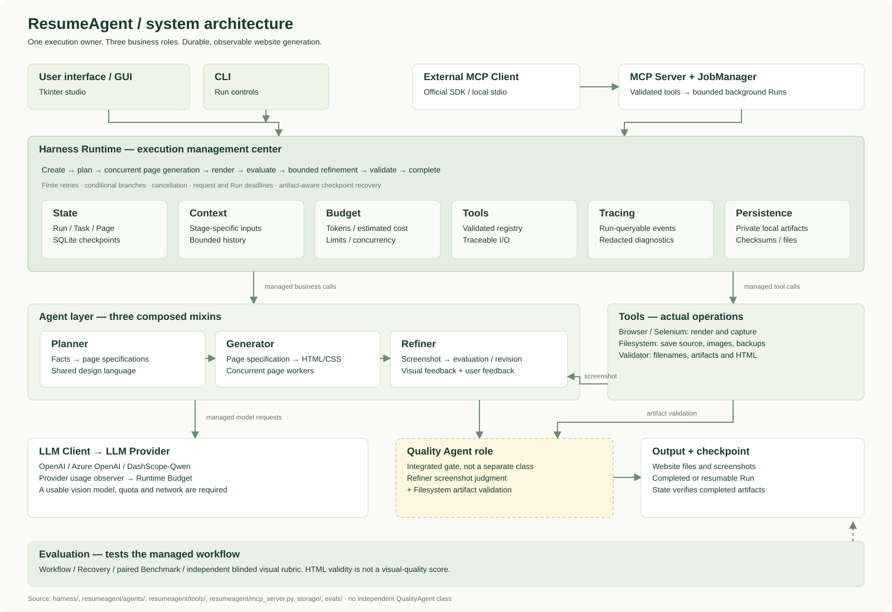

# ResumeAgent 系统架构

[查看完整 SVG](architecture.svg)

本文保留既有系统架构图。GUI、命令行和 MCP 共用 Runtime；业务推理由 Planner、Generator、Refiner 分工完成。`HomepageDesignAgent` 是组合这些能力的会话入口，不是另一套调度器。

## 执行与数据流

1. **创建 Run**：Runtime 保存资料、反馈、配置和预算的任务快照。MCP 使用官方 SDK，通过 JobManager 创建由 Runtime 管理的后台任务。
2. **规划**：Context 组装阶段输入，Planner 返回页面规格。原有 JSON 标签协议和页面字段仍是下游的数据契约。
3. **生成**：Runtime 为各页面建立 Page 状态并运行异步工作单元。模型请求受并发信号量限制；共享 Selenium 会话由浏览器锁保护。
4. **渲染与评价**：Generator 返回代码；统一工具入口负责保存和浏览器截图。Refiner 的 `evaluate_screenshot_async` 返回是否需要修改及反馈，Runtime 决定是否继续迭代。
5. **精修与校验**：Refiner 根据代码、截图和反馈修改页面；文件校验检查产物与指纹。StateStore 将 Task 结果与 Page 进度保存为检查点。恢复时先检查已完成产物，再跳过有效页面。
6. **资源与取消**：Budget 记录服务商返回的用量并估算成本，限制请求、时限和迭代。取消不能保证终止已经发出的服务商请求；Runtime 会等待其收尾并记录迟到用量。
7. **追踪与诊断**：按 Run ID 保存阶段、模型、工具、用量、耗时和错误元数据。本地诊断会脱敏已知凭证与保存的资料值；公开结构化追踪不包含模型完整输入输出。

## 职责边界

| 模块 | 输入 → 输出 | 负责的问题 |
|---|---|---|
| Planner | 用户资料、参考 → 页面规格 | 内容组织与统一设计语言 |
| Generator | 事实、页面规格 → HTML / CSS | 初始网页实现 |
| Refiner | 截图、代码、反馈 → 评价或修改 | 有限的视觉迭代 |
| Runtime | Run ID → 持久化执行结果 | 顺序、分支、重试、并发与取消 |
| State | 阶段结果 → 检查点 | Run / Task / Page 状态及恢复 |
| Context | 资料、规划、页面 → 阶段上下文 | 避免无关历史持续累积 |
| Budget | 限额、用量 → 执行许可 | Token、估算成本、时间与并发约束 |
| Tools | 校验后的工具参数 → ToolResult | 可追踪的实际文件与浏览器操作 |
| Tracing | 执行事件 → 结构化记录 | 查询过程和定位故障 |
| Browser | HTML 路径 → 截图或预览窗口 | 真实 Selenium 渲染 |
| Filesystem / Validator | 页面规格、代码 → 文件与校验 | 输出路径约束、结构和产物完整性 |
| MCP / JobManager | 工具请求 → Run ID、状态、预览信息 | 本地 stdio 传输、任务管理及访问检查 |
| Evals | 固定输入、执行结果 → 测试报告 | 工作流、恢复与成对对比实验 |

## 质量检查的准确含义

图中的 Quality 角色由 **Refiner 截图评价和 Filesystem 校验**实现，没有独立的 `QualityAgent` 类，也没有新增一个自主 Agent 调度层。HTML 有效不等于视觉设计优秀；离线 Mock Benchmark 不代表真实模型质量。

项目未引入 LangChain、LangGraph 或复杂的自主多 Agent 协作框架。SQLite 保存私有本地状态，不加密，不应提交到仓库。生成的 HTML 应作为不受信任内容处理；浏览器工具不是安全沙箱。

## 本地产品展示的来源

`showcase/assets/homepage-studio.png` 与 `homepage-studio-detail.png` 来自原生 Tkinter 窗口：展示脚本只读加载已有的 completed Run、五页规格和实际浏览器截图。按钮不会提交新任务，页面列表仅调整展示密度以完整显示五页。它是已保存结果的真实应用视图，不是重跑录像，也不是 GUI 新增的加载功能。原 GUI、Runtime、数据库和已有产物均不改动。

复现展示截图可使用 `scripts/preview_saved_gui.py --help`。它要求本机保留真实完成的数据库、输出文件和截图，不会随公开仓库提供私人数据库。