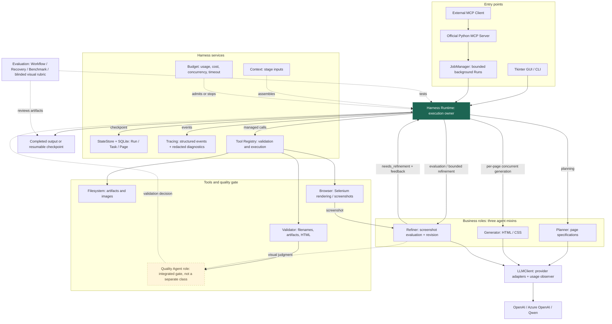

# Architecture

ResumeAgent separates business reasoning from execution ownership. `HomepageDesignAgent`
composes Planner, Generator, Refiner and Filesystem mixins; it is a session facade,
not an independent scheduler. GUI/CLI calls enter Runtime. MCP uses the official
SDK and JobManager, which creates Runtime-owned background jobs.

[Standalone SVG](architecture.svg) · [Editable Mermaid source](architecture.mmd)

## Control and data flow

1. Runtime creates a Run with a copied profile, feedback, settings and limits.
2. Context builds bounded stage inputs. Planner returns page dictionaries. Existing
   JSON/tag protocols and page filenames remain the downstream contract.
3. Runtime creates Page records and runs independent page workers concurrently.
   Each page progresses through generation, rendering, evaluation, optional
   refinement and validation. The model semaphore limits concurrent requests;
   the browser lock serializes a shared Selenium driver.
4. Generator and Refiner return code; registered tools persist files and render
   screenshots. Refiner's `evaluate_screenshot_async` returns
   `needs_refinement` and feedback; Runtime applies the iteration limit.
5. Filesystem validation checks artifacts and computes fingerprints. StateStore
   atomically checkpoints Task results and Page progress in SQLite. Recovery
   verifies completed artifacts before skipping them.
6. Budget records provider-reported usage, estimates cost and controls admission,
   deadlines and cancellation. An already-running provider request may finish
   after cancellation; Runtime drains it and records late usage.
7. Trace events include Run/stage/model/tool identity and resource metadata.
   Local developer diagnostics redact known credentials and saved profile values.
   Model prompts and responses are not part of public structured traces.

## Quality Agent: precise terminology

There is **no independent `QualityAgent` class**. The diagram includes the requested
quality role as a dashed gate implemented by screenshot evaluation in Refiner and
structural/artifact validation in Filesystem. It does not add another model call,
autonomous collaborator or new scheduler. HTML validity is not a visual score.

## Actual module responsibilities

| Component | Input → output | Responsibility |
|---|---|---|
| Planner | Profile / references → page specifications | Content organization and shared design language |
| Generator | Facts / page specification → HTML and optional CSS | Initial implementation |
| Refiner | Facts / screenshot / code / feedback → judgment or revised code | Bounded visual iteration |
| Runtime | Run ID → persisted workflow outcome | Order, branching, retries, concurrency and cancellation |
| Context | Run profile / plan / page → stage context | Avoid unbounded history accumulation |
| StateStore | Stage result → durable checkpoint | Run / Task / Page lifecycle and recovery |
| Budget | Limits / usage events → admission decision | Tokens, estimated cost, time and concurrency |
| Tool Registry | Validated named arguments → ToolResult | Traceable actual I/O |
| Browser | HTML path → PNG or preview window | Selenium; not a security sandbox |
| Filesystem / validators | Page specification / code → files / checksums | Confined output paths and artifact checks |
| MCP Server / JobManager | Validated tool request → Run ID / status / metadata | Local stdio transport, bounded jobs, access checks |
| Evals | Fixed fixtures / executions → measured reports | Workflow and recovery tests; paired benchmarks |

There is no LangChain, LangGraph, vector database or complex autonomous-agent
coordination framework in this implementation. SQLite holds private local state;
it is not encrypted and must not be committed. Generated HTML is untrusted content.
